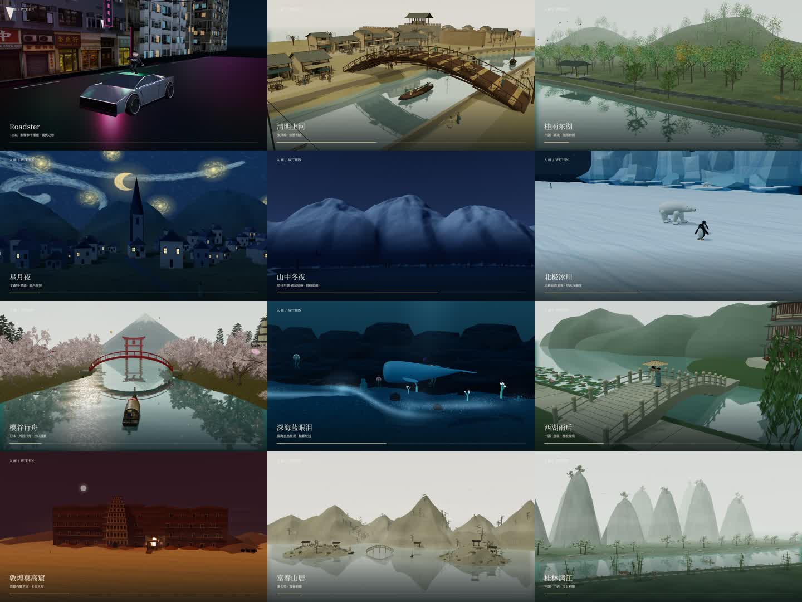

# 入画 · WITHIN

一座可以走进去的三维数字画馆。用浏览器探索 18 个世界，从汴京市井、青绿山水走到樱花河谷与未来街区。

**[在线体验 · GitHub Pages](https://fatasia.github.io/within/)** · **[在线体验 · 腾讯云](http://106.55.242.154/within/)** · **[演示视频](#视频)**



- **18 个交互场景**：绘画、自然景观与 Roadster 试场。[场景目录](docs/SCENES.md)
- **展卷、漫游与步行**：跟随镜头游览，也能走近细节；樱谷支持乘舟。
- **动态场景**：人物舟车、风雨花瓣、昼夜光影与独立配乐。
- **原作对照与取景**：查看七个绘画题材的原作，导出截图或视频。

## 视频

四个视频均可在本页播放，内容与时长完整。内嵌版本经过压缩，1080p 原始成片见 [Releases](https://github.com/fatasia/within/releases)。

### 十二景精选 · 36 秒

<a id="showreel"></a>

https://github.com/user-attachments/assets/c491c230-71bc-4980-a466-2a5cca9b4891

### Roadster · 完整演示 · 55.7 秒

https://github.com/user-attachments/assets/2d096181-0984-41db-a7f1-de93d850a728

### 清明上河 · 晴昼暮夜 · 21 秒

https://github.com/user-attachments/assets/679f51de-3862-4c68-82e4-010332a3c0c1

### 桂雨东湖 · 完整游览 · 2 分 30 秒

https://github.com/user-attachments/assets/2715aa01-13d7-4217-88d4-210a8933f02a

## 开始游览

打开在线体验，选择场景，点击「走进画中」。顶部切换观察方式，底部选择章节或开始自动游览。

- **展卷**：滚轮或拖动调整进度，空格播放；手机使用触摸手势。
- **漫游**：左键平移、右键旋转、滚轮缩放。
- **步行**：WASD / 方向键移动，Shift 加速；手机使用摇杆。

快捷键：`V` 切换视角，`T` 切换天色，`Q` 切换画质，`F` 全屏，`H` 帮助。Roadster 操作以场景提示为准。

推荐开启浏览器硬件加速。声音可在右上角开启；设备卡顿时切换「均衡」或「流畅」。腾讯云入口使用 HTTP，需要安全上下文的功能请使用 GitHub Pages。

## 本地运行

需要 Node.js 22.12+。

```sh
git clone https://github.com/fatasia/within.git
cd within
npm ci
npm run dev
```

```sh
npm run typecheck
npm run lint
npm test
npm run build
```

使用 React、TypeScript、Three.js 和 Vite。构建产物位于 `dist/`，可部署到静态托管服务。

[开发与部署](docs/PROJECT.md) · [视频录制](docs/video-directory.md) · [原作来源](docs/ORIGINALS.md)

## 许可与素材

原创代码采用 [MIT License](LICENSE)。第三方代码、模型、纹理、字体与音乐遵循各自的许可和署名要求：[樱谷资产](docs/sakura-reference.md)、[霓虹街区](public/assets/neon/README.md)、[Roadster 音乐](docs/roadster-music.md)。

绘画场景是三维演绎，不是考古复原；步行支持地形与水面约束，尚无完整建筑碰撞。

[反馈问题](https://github.com/fatasia/within/issues)时，请附场景、设备与浏览器、复现步骤和截图。
